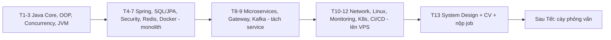

# Lộ trình Java Middle v3 — Chắc nền trước, hệ thống sau, project đắp dần
**Thời gian: 09/11/2026 → 07/02/2027 (13 tuần, chốt trước Tết Đinh Mùi 06/02/2027), sau Tết cày phỏng vấn 3–4 tuần.**
**Kế hoạch chi tiết từng ngày:** [`java-middle-notes/ke-hoach-hang-ngay/`](java-middle-notes/ke-hoach-hang-ngay/README.md)

> v3 giữ nguyên tinh thần v2 (Network, DNS, Gateway, Server, Monitoring, CI/CD thật) nhưng **sửa các lỗ hổng kiến thức nền** và **sắp lại thứ tự** để ưu tiên "nắm chắc từng phần".

---

## 1. Review v2 — cái gì ổn, cái gì thiếu

### ✅ Điểm mạnh của v2 (giữ lại)
- Nguyên tắc 3 đầu ra (nói 2 phút + demo + note 1 trang), demo Chủ nhật, ghi âm trả lời.
- Phần Network/DNS, Server/Monitoring/Alert, CI/CD rất kỹ — hơn hầu hết lộ trình tự học.
- Project "Shop Order & Notification Platform" đúng tầm Middle, có phi chức năng (ăn điểm).
- Ngân hàng câu hỏi DNS / Gateway / Server / CI-CD tốt.

### ⚠️ Vấn đề cấu trúc
| Vấn đề | Hậu quả | Sửa trong v3 |
|---|---|---|
| Tuần 1 nhồi Java Core + Concurrency + JVM + Git | Với người "bắt đầu lại", học lướt → phỏng vấn vòng 1 rớt ở câu cơ bản | Tách thành **3 tuần** (Core+OOP / Collections+Patterns / Concurrency+JVM) |
| Tháng 3 viết lại project từ đầu (4 tuần) trong khi tuần 2–9 đã code các phần | Trùng lặp, tốn 3 tuần | **Đắp project dần từ tuần 4**, tuần 12–13 chỉ hardening + đóng gói |
| Không tính lịch lễ: Giáng sinh, Tết Dương 01/01, **Tết Âm 06/02/2027** | Tuần 13 rơi đúng Tết | Ngày lễ để nhẹ, tuần 13 dồn việc vào Thứ 2–4 |
| Không có DSA/live coding | JD Middle (VPBank, EPAM…) ghi rõ DSA/CS fundamentals | **LeetCode 3–5 bài/tuần** xuyên suốt (~60 bài trước Tết) |
| Ngân hàng câu hỏi thiếu Java Core, Spring, JPA, SQL, Kafka, Redis, Security | Đây lại là 60–70% câu hỏi thực tế | Bổ sung (mục 5) + 10 câu/tuần trong file từng ngày |

### ❌ Kiến thức còn thiếu (đã thêm vào v3)
Đối chiếu JD Java Middle trên ITviec (MB Bank, EPAM, VPBank Securities, MSB/SBSI, LG CNS, bbv) và roadmap.sh/java, roadmap.sh/questions/java (tra cứu 11/2026):

| Nhóm | Thiếu ở v2 | Thêm vào tuần |
|---|---|---|
| Java Core | Pass-by-value, String Pool/immutability, Integer cache, BigDecimal cho tiền, static/final, OOP 4 tính chất, abstract vs interface, Reflection, Annotation, Serialization/`transient` | 1, 4 |
| Thiết kế | **SOLID**, **Design Patterns** (Singleton, Factory, Builder, Strategy, Observer, Proxy, Template, Chain of Responsibility, Adapter, Decorator) | 1, 2 |
| Concurrency/JVM | Java Memory Model/happens-before, CAS, ThreadLocal leak, 7 tham số ThreadPoolExecutor, ClassLoader, các loại OOM, heap/thread dump thực hành | 3 |
| Spring | Bean scope, lifecycle, **proxy JDK vs CGLIB, self-invocation `@Transactional`**, auto-configuration, circular dependency, Filter vs Interceptor, `@Async`, `@Scheduled` + ShedLock, file upload, MapStruct/Lombok, logging SLF4J + MDC, Maven | 4 |
| Database | Chuẩn hóa, ACID, **MVCC**, optimistic/pessimistic lock (`@Version`), oversell, HikariCP, NoSQL (MongoDB/Elasticsearch) mức trade-off | 5 |
| Security | OWASP chi tiết (IDOR, SQL injection), HS256 vs RS256, refresh token rotation, revoke JWT, OAuth2 Authorization Code + PKCE, Client Credentials | 6 |
| Redis | Cache penetration/breakdown/avalanche, eviction, RDB vs AOF, Sentinel vs Cluster, distributed lock đúng cách | 7 |
| Docker | **Dockerfile multi-stage, layer cache, non-root, JVM trong container, exit 137** (v2 chỉ dùng compose, không học Docker) | 7 |
| API | WebSocket/SSE, HTTP caching, p95/p99 | 7 |
| Microservices | CAP/PACELC, Strangler Fig, contract test, Bulkhead, retry storm | 8 |
| Kafka | ISR/`acks`/`min.insync.replicas`, KRaft, rebalance, consumer lag, Schema Registry, Inbox, CDC/Debezium | 9 |
| Kubernetes | v2 chỉ nhắc "nếu kịp" → thêm 1 ngày K8s cơ bản + debug CrashLoopBackOff/OOMKilled | 11 |
| Vận hành | SLI/SLO, RED/USE, cardinality, graceful shutdown, postmortem blameless | 11 |
| CI/CD | Trivy/Dependabot/gitleaks, OIDC, GitOps (khái niệm), Git nâng cao (`bisect`, `revert` vs `reset`) | 12 |
| Phỏng vấn | System Design có khung trả lời, Behavioral STAR, tự giới thiệu tiếng Anh, AI-assisted coding (JD EPAM/bbv yêu cầu) | 13 |

---

## 2. Nguyên tắc (giữ từ v2, thêm 2 điều)
1. **Mỗi chủ đề = 3 đầu ra:** giải thích miệng 2 phút + demo chạy được + ghi chú 1 trang.
2. **Không học chay.** Đọc xong phải gõ tay, phá thử, sửa lỗi.
3. **Một repo ghi chú + một repo project duy nhất** (`java-middle-notes`, `shop-order-platform`).
4. **Chủ nhật nào cũng demo + ghi âm 10 câu phỏng vấn của tuần.**
5. **(Mới) Chưa nói được thì chưa qua bài:** mỗi ngày có 3 câu "Tự kiểm tra" — trả lời to không nhìn tài liệu, không được thì ôn lại trước khi sang ngày sau.
6. **(Mới) DSA đều đặn, không dồn:** 20–30 phút, 3–5 bài/tuần, ưu tiên pattern (HashMap, two pointers, sliding window, stack, BFS/DFS, binary search, heap, DP cơ bản).

### Lịch chuẩn (đi làm ban ngày)
- Thứ 2–6: 2.5h/tối = 45' lý thuyết + 75' code + 30' ghi chú/tự hỏi đáp (+20' LeetCode các ngày có ghi).
- Thứ 7: 4–5h lab/project. Chủ nhật: 2–3h review, README, luyện miệng.
- ~25h/tuần. Tuần có lễ: ngày lễ chỉ 1–1.5h ôn nhẹ.

---

## 3. Lộ trình 13 tuần (v3)

| Tuần | Ngày | Chủ đề | Đầu ra kiểm chứng | File chi tiết |
|---|---|---|---|---|
| 0 | (đã xong) | Reset + setup, skill audit, CV v0 | compose Postgres + Redis, PR flow | — |
| 1 | 09–15/11 | Java Core nền + OOP + SOLID | Mini Order Engine thuần Java + 10 câu | [tuần 1](java-middle-notes/ke-hoach-hang-ngay/tuan-01-java-core-oop.md) |
| 2 | 16–22/11 | Collections (HashMap internals), Generics, Stream, Java 17/21, Design Patterns | LRU cache, 7 pattern có code | [tuần 2](java-middle-notes/ke-hoach-hang-ngay/tuan-02-collections-generics-patterns.md) |
| 3 | 23–29/11 | Concurrency + JVM + GC | Thread dump, heap dump thật, rate limiter | [tuần 3](java-middle-notes/ke-hoach-hang-ngay/tuan-03-concurrency-jvm.md) |
| 4 | 30/11–06/12 | Spring Core/Boot/MVC bên trong | shop-order-platform khung monolith | [tuần 4](java-middle-notes/ke-hoach-hang-ngay/tuan-04-spring-core-boot-mvc.md) |
| 5 | 07–13/12 | SQL sâu + JPA/Hibernate | Báo cáo tối ưu SQL có số liệu, chống oversell | [tuần 5](java-middle-notes/ke-hoach-hang-ngay/tuan-05-sql-jpa.md) |
| 6 | 14–20/12 | Spring Security + JWT + Testing | Auth + RBAC + Testcontainers xanh | [tuần 6](java-middle-notes/ke-hoach-hang-ngay/tuan-06-security-testing.md) |
| 7 | 21–27/12 | API design, Idempotency, Redis, Performance, Docker sâu | Monolith Docker hóa + bảng performance | [tuần 7](java-middle-notes/ke-hoach-hang-ngay/tuan-07-api-redis-performance-docker.md) |
| 8 | 28/12–03/01 | Microservices + API Gateway + Resilience + Tracing | Gateway + 3 service, demo circuit breaker | [tuần 8](java-middle-notes/ke-hoach-hang-ngay/tuan-08-microservices-gateway.md) |
| 9 | 04–10/01 | Kafka, RabbitMQ, Outbox, Saga, CQRS | Luồng đặt hàng async + 4 demo lỗi | [tuần 9](java-middle-notes/ke-hoach-hang-ngay/tuan-09-kafka-distributed.md) |
| 10 | 11–17/01 | Network, DNS, TLS, Nginx, Linux | Domain HTTPS trên VPS, backup/restore | [tuần 10](java-middle-notes/ke-hoach-hang-ngay/tuan-10-network-dns-linux.md) |
| 11 | 18–24/01 | Observability, Alert, Incident, K8s cơ bản | Alert Telegram thật, runbook, minikube | [tuần 11](java-middle-notes/ke-hoach-hang-ngay/tuan-11-observability-k8s.md) |
| 12 | 25–31/01 | CI/CD + Hardening + README | Pipeline xanh + bằng chứng rollback | [tuần 12](java-middle-notes/ke-hoach-hang-ngay/tuan-12-cicd-hardening.md) |
| 13 | 01–07/02 | System Design, CV v1, Behavioral, nộp job, **Tết** | CV v1, đã nộp 5–10 job | [tuần 13](java-middle-notes/ke-hoach-hang-ngay/tuan-13-system-design-dong-goi.md) |



---

## 4. Project: Shop Order & Notification Platform (đắp dần, không viết lại)

| Tuần | Project tiến hóa thế nào |
|---|---|
| 4 | Monolith modular: user/product/order, error contract, validation, MDC log, upload ảnh, `@Scheduled` |
| 5 | Postgres + Flyway, chống oversell, keyset pagination, báo cáo SQL |
| 6 | JWT + refresh + RBAC, unit + integration test (Testcontainers) |
| 7 | Idempotency, rate limit, Redis cache, k6, Dockerfile multi-stage |
| 8 | Tách Auth/Catalog/Order + Gateway + Resilience4j + Zipkin |
| 9 | Inventory, Payment mock, Notification; Kafka + Outbox + Saga + DLT |
| 10 | Lên VPS: domain, Nginx HTTPS, ufw, backup |
| 11 | Prometheus/Grafana/Alertmanager→Telegram, Loki, Uptime Kuma, minikube |
| 12 | GitHub Actions CI/CD, Trivy, approve prod, rollback, README hoàn chỉnh |

**Kiến trúc cuối:**
```
Client → DNS → Nginx (HTTPS) → API Gateway (JWT, rate limit, routing)
  → Auth | Catalog (Postgres + Redis) | Inventory | Order (Postgres + Outbox) | Payment Mock | Notification
  ↕ Kafka: order.created, inventory.reserved/failed, payment.completed/failed, order.confirmed/cancelled
  ↕ Redis: cache, rate limit, idempotency key, distributed lock
  ↕ Observability: Actuator + Prometheus + Grafana + Alertmanager → Telegram, Loki, Zipkin, Uptime Kuma
  ↕ CI/CD: GitHub Actions → staging tự động, production approve tay, rollback theo image tag
```
Yêu cầu chức năng & phi chức năng giữ như v2.

---

## 5. Ngân hàng câu hỏi phỏng vấn

> Các nhóm **DNS & Network, API Gateway, Server/Giám sát, CI/CD, System Design** giữ nguyên như v2 (xem [v2](lo-trinh-java-middle-3-thang-v2.md#ngân-hàng-câu-hỏi-phỏng-vấn--phải-trả-lời-tự-tin-tự-luyện-miệng)). Dưới đây là các nhóm **bổ sung** — đây là phần bị hỏi nhiều nhất.

### Java Core & OOP
1. JDK/JRE/JVM; Java chạy từ source đến mã máy (bytecode, JIT).
2. Stack vs Heap; Java pass-by-value hay reference?
3. String immutable vì sao; String Pool; String vs StringBuilder vs StringBuffer.
4. `==` vs `equals`; hợp đồng equals/hashCode.
5. Abstract class vs interface (sau Java 8); overloading vs overriding.
6. Checked vs unchecked exception; try-with-resources; `finally` có luôn chạy?
7. SOLID với ví dụ thực tế; composition over inheritance.
8. 3–4 design pattern bạn đã dùng thật trong dự án; Singleton thread-safe.
9. Record, sealed class, pattern matching dùng khi nào?
10. Vì sao tiền dùng BigDecimal; `equals` vs `compareTo` của BigDecimal.

### Collections & Stream
1. HashMap hoạt động thế nào (hash, bucket, treeify, resize, load factor).
2. HashMap vs Hashtable vs ConcurrentHashMap (Java 7 vs 8).
3. ArrayList vs LinkedList; fail-fast vs fail-safe.
4. Type erasure, PECS.
5. `map` vs `flatMap`; `orElse` vs `orElseGet`; khi nào tránh parallelStream.

### Concurrency & JVM
1. synchronized vs volatile vs Atomic; happens-before.
2. Deadlock: điều kiện, phòng tránh, phát hiện trên production.
3. 7 tham số ThreadPoolExecutor; queue đầy thì sao; vì sao tránh `Executors.newFixedThreadPool`.
4. CompletableFuture kết hợp & xử lý lỗi; `@Async` cấu hình thế nào.
5. Virtual Thread: là gì, khi nào dùng, pinning.
6. Cấu trúc bộ nhớ JVM; G1 GC; Minor vs Full GC.
7. App OOM trên production — các bước xử lý (heap dump, MAT).
8. ThreadLocal dùng ở đâu, leak khi nào.

### Spring & JPA
1. IoC/DI; vì sao constructor injection; bean scope; singleton bean có thread-safe?
2. Bean lifecycle; BeanPostProcessor tạo proxy ở đâu.
3. AOP, JDK proxy vs CGLIB; **vì sao `@Transactional` không chạy khi self-invocation / method private**.
4. Auto-configuration hoạt động thế nào.
5. Luồng request Spring MVC; Filter vs Interceptor vs AOP.
6. Transaction propagation (`REQUIRED` vs `REQUIRES_NEW`), isolation, rollback checked exception.
7. Entity lifecycle, persistence context, dirty checking; `persist` vs `merge`.
8. N+1: nguyên nhân, 3–4 cách fix; fetch join + phân trang có vấn đề gì.
9. LazyInitializationException; vì sao tắt open-in-view.
10. `@Scheduled` chạy nhiều instance thì sao (ShedLock).

### SQL & Database
1. ACID; 4 mức isolation và hiện tượng; mặc định Postgres/MySQL.
2. B-Tree index, composite index (leftmost prefix), covering index; khi nào index không được dùng.
3. Đọc EXPLAIN ANALYZE — kể 1 lần tối ưu query có số liệu.
4. MVCC là gì; optimistic vs pessimistic lock; chống oversell.
5. Deadlock DB; long transaction.
6. Phân trang dữ liệu lớn (offset vs keyset).
7. SQL vs NoSQL; khi nào MongoDB, khi nào Elasticsearch.
8. Replication vs sharding.

### Security
1. Authentication vs authorization; Spring Security filter chain.
2. JWT cấu trúc; HS256 vs RS256; JWT vs session.
3. Refresh token lưu ở đâu, rotation, revoke/logout.
4. OAuth2 vs OIDC; Authorization Code + PKCE; Client Credentials.
5. CORS vs CSRF; SQL injection; IDOR.
6. Hash vs encrypt vs encode; vì sao BCrypt.

### Redis & Kafka
1. Cache-aside; update DB rồi xóa cache hay ngược lại?
2. Cache penetration / breakdown / avalanche.
3. Distributed lock bằng Redis đúng cách; RDB vs AOF; Sentinel vs Cluster.
4. Kafka: partition, consumer group, offset; giữ thứ tự message.
5. Mất message / trùng message; at-least-once vs exactly-once.
6. Retry + DLQ; Outbox; Saga choreography vs orchestration.
7. Kafka vs RabbitMQ; consumer lag cao xử lý thế nào.

### Behavioral
1. Giới thiệu bản thân 1–2 phút (Việt + Anh).
2. Bug/incident production khó nhất.
3. Bất đồng kỹ thuật với lead/đồng nghiệp.
4. Bạn dùng AI coding assistant thế nào mà vẫn đảm bảo chất lượng?
5. Vì sao chuyển việc; mong muốn 1–2 năm tới.

---

## 6. Checklist "đủ tự tin đi phỏng vấn"
- [ ] Trả lời trôi chảy ≥ 80% ngân hàng câu hỏi (v2 + v3) không nhìn tài liệu.
- [ ] Vẽ & giải thích HashMap, bean lifecycle, luồng Spring Security, luồng DNS → TCP → TLS → Nginx → Gateway → Service → DB trong 3 phút mỗi cái.
- [ ] Giải ~60 bài LeetCode (easy + medium), làm được 1 bài medium trong 25 phút vừa code vừa nói.
- [ ] Kể được project ở 3 độ dài (2' / 5' / 15') với số liệu thật.
- [ ] Demo được: đặt hàng → Kafka/Saga → Grafana → alert Telegram → pipeline → rollback.
- [ ] Repo có README, sơ đồ, ADR, pipeline xanh.
- [ ] CV v1 (Việt + Anh) có số liệu; đã nộp ≥ 5 job trước Tết.
- [ ] Đã chuẩn bị 6 câu chuyện STAR.

**Sau Tết (15/02 → 15/03/2027):** mỗi ngày 2h: flashcard Java/Spring/SQL + 1 LeetCode medium + ôn note tuần yếu; mỗi tuần 2 bài System Design + 1–2 mock interview ghi âm; sau mỗi buổi phỏng vấn thật ghi lại câu hỏi trong 30 phút.

